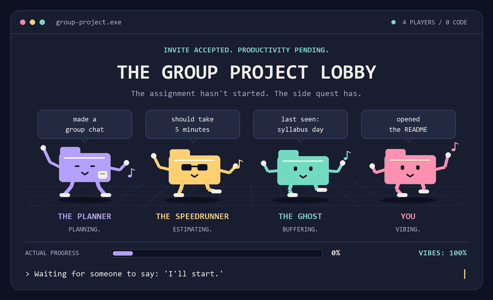

*This project has been created as part of the 42 curriculum by bhajili, kqaddour, nakhalil, zsid-ele, aradwan.*

# WOZU Web

> Status: in development (sprint 1 of 4). Sections with a TODO comment are filled by the owner card named in the comment; nothing below describes a feature as finished unless it exists in the repository.
<!-- TODO DOC-06 (byul-byul): remove the Status line before submission. -->

## Description

**WOZU Web** is a job platform for the web. A candidate applies to a job with a short video instead of a CV, talks to employers in real-time chat, and can play a social-deduction mini-game called the Turing Duel. The project is a new backend and a new web frontend, built on top of the WOZU backend as a reference.

**Goal:** a complete web application (frontend, backend, database) that meets the ft_transcendence subject and runs with a single command.

**Key features (planned; the Features List section records what is implemented):**

- Video-based job applications instead of CVs.
- Real-time chat between candidates and employers.
- Turing Duel: a multiplayer mini-game in which humans and bots chat, and each human guesses who is a bot. The full rules are in [docs/game/turing-duel-rules.md](docs/game/turing-duel-rules.md).

Planning documents (roles, module plan, API contract, infrastructure) are in [docs/](docs/README.md).

## Instructions

<!-- TODO DOC-05 (byul-byul): prerequisites (software, tools, versions), .env setup, step-by-step run with make, Mailpit at /mail. Only commands that work. -->

## Resources

<!-- TODO DOC-07 (Zayid): classic references (documentation, articles, tutorials) and the final description of how AI was used, for which tasks and which parts. -->

**AI usage (running list, incomplete until DOC-07):**

- The plan documents in `docs/` were drafted with AI assistance (Claude) and reviewed by the team.
- The Trello card plan and card texts were drafted with Claude and approved by the Product Owner.
- DOC-08 (the Turing Duel rules text) was written with Claude Code.
- INF-01 (nginx + ModSecurity proxy configuration, certificate script, verification) was written with Claude Code.
- Each owner must review, test and be able to explain their AI-assisted work; this list is not evidence that every owner has already completed that preparation.
- Codex assisted the November 8 review of this README skeleton, including checking required sections and correcting the owner-preparation statement. This does not replace each owner's review or defense practice.

## Team Information

| Member | 42 login | GitHub | Role(s) | Responsibilities |
| --- | --- | --- | --- | --- |
| Burhan | bhajili | byul-byul | Product Owner + Developer (DevOps) | Product vision, backlog priorities, acceptance of finished cards, README and legal pages content; Docker, nginx + ModSecurity / TLS, monitoring, security modules |
| Khalil | kqaddour | Khalil-QadDoura | Technical Lead + Developer (Backend A) | Backend architecture and API contract, stack decisions, review of critical PRs, code quality rules |
| Nader | nakhalil | NaderZico | Developer (Backend B) | Ports and owns backend modules |
| Zayid | zsid-ele | zayidelkhair | Project Manager / Scrum Master + Developer (Frontend A) | Runs the Trello board and the weekly sync, tracks deadlines and blockers, keeps the risk list; frontend modules |
| Ahmad | aradwan | a7mdwr | Developer (Frontend B) | Owns frontend modules |

<!-- TODO DOC-06 (byul-byul): each member checks their own row before submission; add the module names once the work split is final. -->

## Project Management

<!-- TODO DOC-04 (Zayid): how the work is organized (task distribution, meetings), tools, communication channels. -->

Trello is used for planning and GitHub pull requests for code and documentation review.

## Technical Stack

Decided stack (starting point):

- Frontend: React, TypeScript, Vite, Tailwind CSS; React Router, TanStack Query, react-i18next, native WebSocket.
- Backend: FastAPI; Celery moderation worker.
- Data: PostgreSQL with PostGIS, Redis; MinIO for files (served at `/files`).
- Email in development: Mailpit (served at `/mail`).
- Edge and operations: nginx with ModSecurity (OWASP CRS) as front proxy; Vault; Prometheus and Grafana.

<!-- TODO DOC-05 (byul-byul): justification for each major technical choice, including why PostgreSQL. -->

## Database Schema

<!-- TODO BE-14 (Khalil): visual representation or description of the schema; tables and relationships; key fields and data types. -->

## Features List

<!-- TODO DOC-06 (byul-byul): complete list of implemented features, owner(s) of each, short description of each. Implemented features only. -->

## Modules

<!-- TODO DOC-06 (byul-byul): one row per chosen module, with justification and implementation notes. Add rows only for modules that work. -->

| Module | Type | Points | Owner(s) | How it was implemented |
| --- | --- | --- | --- | --- |

**Total points:** TODO DOC-06 (Major = 2, Minor = 1).

## Individual Contributions

<!-- TODO DOC-07 (Zayid): per member, what they built (features, modules, components), plus challenges faced and how they were overcome. -->

## Known limitations

<!-- TODO DOC-06 (byul-byul), filled before submission: honest list of what does not work or is missing. -->

## Credits

The animated GIF below and its generator ([tools/make_lobby.py](tools/make_lobby.py)) were added to this repository by Zayid Elkahir.

<!-- TODO DOC-07 (Zayid): confirm the author of the GIF and the license/attribution to write here. -->

