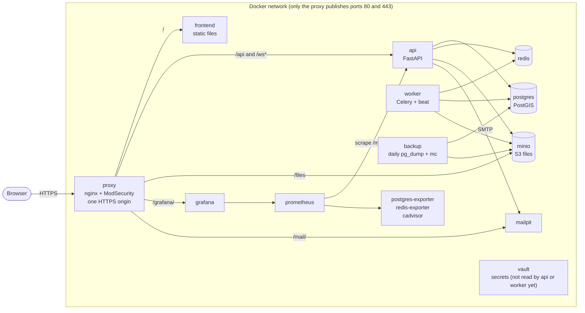
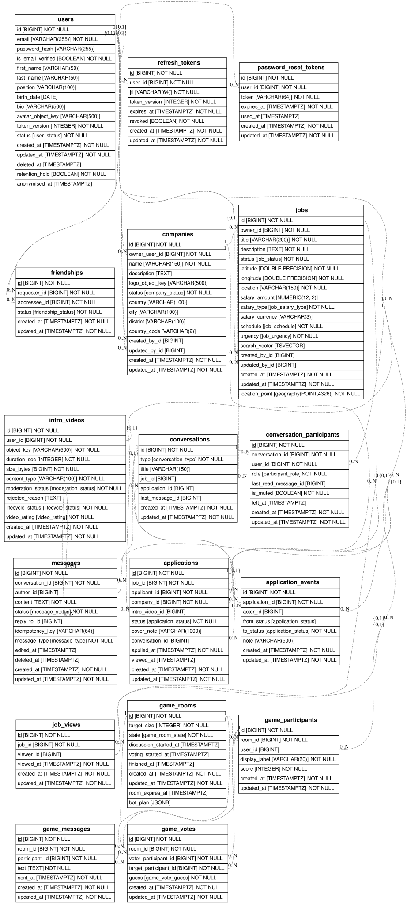

*This project has been created as part of the 42 curriculum by bhajili, kqaddour, nakhalil, zsid-ele, aradwan.*

# WOZU Web

## Description

**WOZU Web** is a job platform for the web. A candidate applies to a job with a short video instead of a CV, talks to employers in real-time chat, and can play a social-deduction mini-game called the Turing Duel. The project is a new backend and a new web frontend, built on top of the WOZU backend as a reference.

**Goal:** a complete web application (frontend, backend, database) that meets the ft_transcendence subject and runs with a single command.

**Key features (planned; the Features List section records what is implemented):**

- Video-based job applications instead of CVs.
- Real-time chat between candidates and employers.
- Turing Duel: a multiplayer mini-game in which humans and bots chat, and each human guesses who is a bot. The full rules are in [docs/game/turing-duel-rules.md](docs/game/turing-duel-rules.md).

Planning documents (roles, module plan, API contract, infrastructure) are in [docs/](docs/README.md).

## Instructions

Everything runs in containers; the host needs no Node.js, Python or PostgreSQL. One command, `make`, takes a fresh clone to a running site.

### Prerequisites

- **Docker Engine 25 or newer** (the health checks use `start_interval`, which Engine 24 refuses) with **Docker Compose v2** (`docker compose`). Docker Desktop for Mac or Windows includes both.
- **make**, **bash**, **openssl** (`make` uses openssl to generate the secrets and the certificate) and **python3 3.9 or newer** (`make` reads Vault's answers with it while it initializes and unseals Vault).
- Free host ports **443** (HTTPS) and **80** (redirect to HTTPS). Only the proxy publishes ports. If one is taken, start with `HTTPS_PORT=8443 make` (or set `HTTPS_PORT` / `HTTP_PORT` in `.env` and run `make`): `make` writes the port into the public URLs in `.env` (`FRONTEND_BASE_URL`, `MINIO_EXTERNAL_ENDPOINT`), and every URL below then needs `:8443`, the redirect URI registered for login with 42 too (`https://localhost:8443/api/auth/oauth/42/callback`).
- Resources: about 2.5 GB of memory for the running stack (15 containers after `make`, measured with `docker stats --no-stream` at about 2.2 GB idle on 2026-11-24; the largest are `worker`, `vault` and `grafana`); give Docker at least 4 GB, because building the images needs more than running them. Allow several GB of disk for images and volumes. The first `make` downloads the images and builds the frontend and backend, so it needs internet access and takes a few minutes.

### Run it

1. Clone the repository and go into it:

   ```sh
   git clone https://github.com/Khalil-QadDoura/ft_transcendence.git
   cd ft_transcendence
   ```

2. Run `make`. It is the same as `make env ports up` and does this, in order:
   - `make env` creates `.env` from `.env.example` and fills every empty secret (`JWT_SECRET`, `INTERNAL_API_KEY`, `POSTGRES_PASSWORD`, `MINIO_ROOT_PASSWORD`, `GRAFANA_ADMIN_PASSWORD`) with a random value from `openssl rand`. `.env` is readable by its owner only and is never committed. If `.env` already exists, no line of it changes; only keys that `.env.example` gained since are appended. Copying `.env.example` by hand is not needed and would leave the secrets empty.
   - `make ports` writes the HTTPS port into the public URLs in `.env` (`FRONTEND_BASE_URL`, `MINIO_EXTERNAL_ENDPOINT`) when `HTTPS_PORT` is not 443, and removes it again when it is 443 (`scripts/ports.sh`).
   - `make certs` creates a self-signed certificate for `localhost` in `infra/proxy/certs/` (kept if it already exists).
   - `make vault-init` starts Vault alone and runs `scripts/vault-init.sh`. The first time, it initializes Vault (3 key shares, 2 of them unseal it) and writes the key shares and the root token to `scripts/vault-keys.local`, readable by its owner only and never committed. Every time, it unseals Vault, which starts sealed after each container start, and applies its configuration (secrets store, AppRole roles and policies, audit log). Keep that file: without it a sealed Vault cannot be unsealed. The services do not read their secrets from Vault yet (INF-13); they still come from `.env`.
   - `docker compose up -d --build --wait` builds the images, starts the stack and returns once every service is running and healthy. It fails if a service exits. The `backup` service takes a first backup at start when it finds none from the last 24 hours.
   - At the end it prints the address of the site and of the mail inbox.

   ```sh
   make
   ```

3. Open <https://localhost/>. The browser warns about the certificate because it is self-signed; accept it once. (With another `HTTPS_PORT`, use `https://localhost:<port>/`.)
4. Sign up at `/register`. The verification email does not go to a real mailbox: it lands in Mailpit at <https://localhost/mail/>. Open the message, follow its link, then log in at `/login`.

`OPENAI_API_KEY` in `.env` is the only value added by hand, and only for video moderation. The site starts without it.

### Addresses

| What | Address | Notes |
| --- | --- | --- |
| The app | <https://localhost/> | Frontend, with the API under `/api` and WebSockets under `/ws` on the same origin |
| Status page | <https://localhost/status> | Public, shows each component as up or down |
| Game rules | <https://localhost/game/rules> | Rules of the Turing Duel |
| Privacy Policy | <https://localhost/privacy> | |
| Terms of Service | <https://localhost/terms> | |
| Mail inbox (Mailpit) | <https://localhost/mail/> | Every email the app sends, including the verification link |
| Grafana | <https://localhost/grafana/> | User `admin`; the password is `GRAFANA_ADMIN_PASSWORD` in `.env` (generated by `make`) |

### Demo accounts

Once `make` finishes, run `make seed` to load demo data (2 employers with companies and logos, 4 candidates with avatars, 20 open jobs across Abu Dhabi and Baku, applications across every status, friendships, direct conversations, and approved intro videos). It never runs automatically on startup and is safe to re-run (idempotent). Add `moderate=1` (`make seed moderate=1`) if `OPENAI_API_KEY` is set and you also want one pending sample video queued to the worker.

All demo accounts share the same demo-only password: `WozuDemo2026!`

| Role | Email | Notes |
| --- | --- | --- |
| Employer (Abu Dhabi) | `employer1@wozu.demo` | Owns **Falcon Robotics AE** (10 open jobs + 1 draft, applicant chats) |
| Employer (Baku) | `employer2@wozu.demo` | Owns **Caspian Cloud Systems** (10 open jobs + 1 draft, hired candidate) |
| Candidate | `candidate1@wozu.demo` | Full-Stack Engineer; Grade A posted pitch + rejected sample video, unread chats |
| Candidate | `candidate2@wozu.demo` | DevOps & SRE Specialist; Grade A posted pitch, hired & incoming friend request |
| Candidate | `candidate3@wozu.demo` | Product Designer; Grade B posted pitch, shortlisted application |
| Candidate | `candidate4@wozu.demo` | Junior Backend Developer; Grade B posted pitch, submitted & rejected applications |

To wipe all app rows/media and re-seed from scratch at any time, run `make reset-demo`.

### Tests and checks

- `make test`: runs the backend `ruff check`, `ruff format --check` and `pytest` in a throwaway container, against a separate test database and its own Redis, then the frontend lint, format check, type check and unit tests. It fails if any backend test is skipped. It needs `.env` (it creates it) and the Docker images, not a running site.
- `make https-check`: the routes of the one HTTPS origin: frontend, `/api`, the `/ws` handshake, the redirects, and the internal routes returning 404. Needs the running stack.
- `make files-check`: file upload and download through `/files` with presigned URLs. Needs the running stack and `curl`.
- `make mail-check`: register, find the email in Mailpit, follow its link, verify, log in; deletes the message afterwards. Needs the running stack.
- `make images-check`: fails if an image in compose, a Dockerfile or a CI workflow is not pinned by tag and digest. Needs no running stack.
- `make secrets-check`: no secret in any commit of any branch, with gitleaks on a fresh mirror clone, so it never reads `.env`; prints `REDACTED` instead of a value. Needs no running stack, only Docker and git.
- `make metrics-check`: every Prometheus target is up and returns data; the five alert rules pass `promtool check rules` and `promtool test rules` and are loaded. Needs the running stack, `curl` and python3 3.9 or newer.
- `make grafana-check`: Grafana login, security settings, data source, both dashboards and the Firing alerts panel. Needs the running stack, `curl` and python3 3.9 or newer.
- `make vault-check`: Vault is initialized, unsealed and configured; each AppRole role (`api`, `worker`) reads only its own path; the audit log holds no credential in clear; no host port. Needs the running stack.
- `make backup-check`: runs `make backup`, then checks the newest database dump (every app table) and files copy (object count, one checksum), the catch-up at start, retention (none older than 7 days, at most 7) and that the backups are neither published nor reachable through the proxy. Needs the running stack.
- `make alert-demo`: not a check, a manual demo (not in CI). It stops Redis, prints the seconds until the RedisDown alert fires, keeps Redis down 25 s more so the Grafana "Firing alerts" panel shows it (`ALERT_HOLD_SEC=0 make alert-demo` skips that), starts Redis again and prints when the alert is resolved. Redis is started again however it ends. Needs the running stack.
- `make anonymise-deleted`: not a check. It runs the second stage of account deletion now instead of at the worker's nightly run: accounts deleted more than 30 days ago are anonymised; `days=0` takes every deleted account (for a demo). Needs the running stack.
- `make schema-diagram`: not a check. It regenerates `docs/db/schema.svg` (the picture in [Database Schema](#database-schema)) from the migrations; run it after a migration changes the schema.

### Stop, logs and reset

| Command | What it does | What it deletes |
| --- | --- | --- |
| `make down` | Stops the stack. | Containers and the network. **Keeps** the data volumes, `.env` and the certificate. The Mailpit inbox is lost (it lives in its container). |
| `make logs` | Follows the last 100 log lines of every service; `make logs s=api` follows one. Ctrl-C stops following, the stack keeps running. | Nothing. |
| `make logs-reset` | Empties the logs by removing stopped containers and recreating the running ones. The new Vault container starts sealed, so it unseals Vault again with `scripts/vault-init.sh`. | Logs and the Mailpit inbox. **Keeps** the data volumes. Meant to be run at least weekly, so logs stay at most 30 days. |
| `make seed` | Loads demo users, companies, 20 open jobs, applications, friendships, chats and approved pitch videos (idempotent). | Nothing (keeps existing data). |
| `make reset-demo` | Truncates app tables, deletes uploaded/seeded objects and re-runs `make seed`. | All database rows and bucket files in MinIO. **Keeps** `.env`, secrets and metrics. |
| `make fclean` | Full clean-up. | **All data**: containers, the volumes (database, Redis, files and videos in MinIO, Prometheus metrics, Grafana, Vault, and every backup), the images built here (and the frontend test image) and the certificate in `infra/proxy/certs/`. It moves `scripts/vault-keys.local` aside to `scripts/vault-keys.local.stale-<UTC time>`, because its Vault is gone. **Keeps** `.env`, because the next database volume is created with the secrets in it, and downloaded base images. |
| `make re` | `make fclean`, then `make`. | The same as `make fclean`, then a fresh start from scratch. |

`make fclean` and `make re` cannot be undone: every account, video and message is lost, and so is every backup. To also start with new secrets, delete `.env` by hand before `make`.

### Backups and restore

The `backup` service copies the app database (`pg_dump`) and the file bucket into the `backups` volume every day at 03:00 Asia/Dubai, and once at start when the newest copy is 24 hours old or more. Each copy is verified before it is kept; copies older than 7 days are deleted, and at most 7 are kept. `make backup` takes one now, `make backup-list` lists them, and `make restore BACKUP=latest` (or a timestamp from the list) puts one back after asking. The copies are on the same machine as the data, so they do not survive losing the machine. What is copied, the restore steps and the tested runbook: [docs/disaster-recovery.md](docs/disaster-recovery.md).

## Resources

<!-- TODO DOC-07 (Zayid): classic references (documentation, articles, tutorials) and the final description of how AI was used, for which tasks and which parts. -->

**AI usage (running list, incomplete until DOC-07):**

- The plan documents in `docs/` were drafted with AI assistance (Claude) and reviewed by the team.
- The Trello card plan and card texts were drafted with Claude and approved by the Product Owner.
- DOC-08 (the Turing Duel rules text) was written with Claude Code.
- INF-01 (nginx + ModSecurity proxy configuration, certificate script, verification) was written with Claude Code.
- Each owner must review, test and be able to explain their AI-assisted work; this list is not evidence that every owner has already completed that preparation.
- Codex assisted the November 8 review of this README skeleton, including checking required sections and correcting the owner-preparation statement. This does not replace each owner's review or defense practice.

## Team Information

| Member | 42 login | GitHub | Role(s) | Responsibilities |
| --- | --- | --- | --- | --- |
| Burhan | bhajili | byul-byul | Product Owner + Developer (DevOps) | Product vision, backlog priorities, acceptance of finished cards, README and legal pages content; Docker, nginx + ModSecurity / TLS, monitoring, security modules. Modules: M12, M14; pending: M13 (#94, #103) |
| Khalil | kqaddour | Khalil-QadDoura | Technical Lead + Developer (Backend A) | Backend architecture and API contract, stack decisions, review of critical PRs, code quality rules. Modules: M1, M2, M4, M5, M9, M15; pending: M7, M8, M18 (game server side; the room screen is #86, #88, #98) |
| Nader | nakhalil | NaderZico | Developer (Backend B) | Ports and owns backend modules. Modules: M2, M3, M4, M5, M6, M9, M12, M14; pending: M7, M8, M18 (game server side) |
| Zayid | zsid-ele | zayidelkhair | Project Manager / Scrum Master + Developer (Frontend A) | Runs the Trello board and the weekly sync, tracks deadlines and blockers, keeps the risk list; frontend modules. Modules: M1, M3, M4; pending: M10, M11 (#93), M16 (FE-16, not done) |
| Ahmad | aradwan | a7mdwr | Developer (Frontend B) | Owns frontend modules. Modules: M1, M2, M3, M6, M9; pending: M7, M8, M18 (game room screen: #86, #88, #98) |

Module numbers are those of the [Modules](#modules) table; "pending" modules are not counted yet. Each member checks their own row and confirms or corrects it as a comment on the pull request that last changed this table.

## Project Management

The team divides work by ownership: Burhan is Product Owner and owns infrastructure; Khalil is Technical Lead and Backend A; Nader is Backend B; Zayid is Project Manager / Scrum Master and Frontend A; Ahmad is Frontend B. The [backlog](docs/plan/backlog.md) maps each feature to one owner and its dependencies. The Product Owner maintains priorities and the [decisions log](docs/plan/overview.md); the Technical Lead reviews architecture and API decisions. Zayid tracks deadlines, blockers and review handoffs.

We plan in one-week sprints: November 4–10, 11–17 and 18–24, followed by a shorter November 25–28 sprint. Code freeze is November 26; the first defense is November 29. Deadlines are 18:00 Abu Dhabi (Asia/Dubai, UTC+4). The [Trello board](https://trello.com/b/E3788fBx/fttranscendence) is the live work tracker: **Backlog → To Do → In Progress → Review → Done**. A card identifies its owner, sprint, priority, dependencies and “Done when” checklist. Card IDs such as FE-06 identify work; GitHub PR numbers identify review discussions.

Each card gets a focused branch and pull request. Branches follow `feat/FE-06-i18n-setup` (or `fix/…`, `docs/…`); commits follow `<type>(<scope>): <summary> (<CARD-ID>)`. PRs link the Trello card, describe behavior and validation, and request review from the other pair. The team rule is review within 24 hours. Applicable frontend/backend CI must pass, feedback must be addressed and approval obtained before squash-merging into `main`. A dependent PR names its parent and is retargeted and checked after the parent lands. `main` already requires one approving review and disallows force pushes. Making CI a required check and applying protection to administrators remain INF-06 work.

The [PM-00 board guide](docs/plan/board.md) defines the workflow and Definition of Done. An open PR is **Review**, not **Done**: merge and the card's complete acceptance evidence are required. The live change for merged cards is rehearsed in QA-04 before the defense (Product Owner decision, 2026-11-25); a merged card goes to Done without waiting for it. Study notes support that preparation; they do not replace the owner's demonstration.

Communication uses the team’s WhatsApp group for daily coordination and the daily Done / Next / Blocked update, Trello card comments for implementation questions and blockers, and GitHub for code feedback and review requests. The [PM-01 sprint routine](docs/plan/sprint-routine.md) contains the 30-minute weekly agenda and the daily **Done / Next / Blocked** template. As of November 11, the proposed Tuesday 18:30 weekly slot, weekday 22:00 update cutoff and call details still need team agreement. WhatsApp is the confirmed coordination channel; calendar invitations and pinning the daily-update format are still pending. The GitHub Power-Up is enabled, but repository authorization/linking remains an open PM-01 action; an ordinary PR attachment is not proof of that connection.

This is the Sprint 2 process record, owned by Zayid (DOC-04). Refresh it in Sprint 4 against the decisions, meeting records and actual tool configuration so the final README describes what the team did.

## Technical Stack

Versions are the ones pinned in `docker-compose.yml`, the Dockerfiles and the lock files. Every image is pinned by tag and digest (`make images-check`).

| Component | Technology | Why |
| --- | --- | --- |
| Frontend | React 19, TypeScript 5.9, Vite 8 (built with Node 24, served as static files by nginx) | A typed component UI with a fast build; the team knows React. |
| Styling | Tailwind CSS 4 | Utility classes keep styles next to the components and need no separate design-system code. |
| Routing and data | React Router 7, TanStack Query 5 | Client-side routes with a fallback to `index.html`; Query caches and refreshes server data instead of hand-written state. |
| Languages | i18next 26 with react-i18next 17 | Planned languages are AR, EN, AZ, TR and RU, with right-to-left layout for Arabic, as the language modules require. |
| Backend | FastAPI 0.162 on Python 3.11, Pydantic 2, uvicorn | Async, typed request and response models, and an OpenAPI contract the frontend types are generated from. |
| ORM and migrations | SQLAlchemy 2.0 (async, asyncpg), Alembic | The schema is code: each change is a migration that runs at start (`alembic upgrade head`). |
| Database | PostgreSQL 15 with PostGIS 3.4 | The data is relational (users, companies, jobs, applications, chats) and needs constraints and foreign keys; PostGIS gives the radius search for jobs, and built-in full-text search (`tsvector`) gives the keyword search, with no extra search service. |
| Cache and pub/sub | Redis 7.4 | Fans WebSocket events out between API workers (pub/sub), keeps presence, one-time WebSocket tickets and locks, and is the Celery broker. |
| Real time | Native WebSocket (`/ws`, `/ws/game`), one-time ticket authentication | No library needed in the browser; the ticket (`POST /api/ws/ticket`) keeps the access token out of URLs and logs. |
| Object storage | MinIO (S3 API; `pgsty/minio` rebuild of the upstream release) | Videos and pictures go to the browser by presigned URLs, so uploads skip the API, and the S3 API means the code does not depend on MinIO. Reached through the proxy at `/files`. |
| Mail in development | Mailpit 1.33 | Catches every outgoing email, so a verification link can be followed without a paid mail service or sending user data to a third party. At `/mail/`. |
| Worker | Celery 5.7 with beat, on Redis, same image as the API (with `ffmpeg`) | Video moderation (OpenAI) must not block a request. The `worker` service runs by default (BE-29): it moderates uploaded videos, picks up stuck ones, anonymises deleted accounts every night (BE-34) and writes a heartbeat to Redis that its health check and `/api/health` read. |
| Front proxy and WAF | nginx with ModSecurity v3 and OWASP CRS 4 (image `owasp/modsecurity-crs` 4.30) | One HTTPS origin for everything: no CORS and no mixed content, and one place for TLS, the WAF and blocking internal routes. **Today the WAF runs in `DetectionOnly` mode:** it logs rule matches and blocks nothing, until INF-11 tunes the rules and switches blocking on. |
| Monitoring | Prometheus 3.16, postgres-exporter, redis_exporter, cAdvisor, Grafana 13.3 | Prometheus pulls metrics every 15 s from the API and the exporters and keeps them 30 days (at most 1 GB); Grafana shows two provisioned dashboards, "WOZU API" and "WOZU Infrastructure". Five alert rules (Redis down, a target down, API 5xx share, API p95 latency, monitoring disk), unit-tested with `promtool test rules`, show in a "Firing alerts" panel; `make alert-demo` stops Redis to show one fire and resolve. No host port; Grafana is reached through the proxy. |
| Secrets | HashiCorp Vault 2.2.2 (server mode, file storage) | Keeps secrets out of `.env` and Git. `make` initializes and unseals it; it has a KV v2 store, AppRole roles for `api` and `worker`, each with its own policy, and an audit log (`make vault-check`). **Today** the services do not read it yet: moving their secrets in is INF-13, so the secrets are still in `.env`, generated by `make`. |
| Backups | `backup` service: `pg_dump` / `pg_restore` 15 and MinIO's `mc`, built from the `db` and `minio` images | Recovery from a broken volume, a bad migration or a mistaken delete: a verified daily copy of the database and the files, 7 days kept, and `make restore` (`make backup-check`). Same machine only; see [Backups and restore](#backups-and-restore). |
| CI | GitHub Actions, one workflow (`ci.yml`) with a `ci-ok` gate | One required check on `main`; jobs run only for the parts a pull request changed, and the `stack` job runs `make` on a clean runner. |

### Architecture



The browser talks to one origin, `https://localhost`, and only the proxy publishes host ports. The proxy terminates TLS, runs ModSecurity on every request and sends each path prefix to one service: `/` to the frontend, `/api` and `/ws*` (WebSockets) to the API, `/files` to MinIO, `/grafana/` to Grafana and `/mail/` to Mailpit. Because the frontend, the API and the file URLs share one origin, there is no CORS. Presigned upload and download URLs point at `/files` on the same origin, so file bytes go from the browser through the proxy to MinIO without passing through the API. The proxy answers 404 for `/_internal*` and `/metrics*` (also under `/api`), so those routes stay inside the Docker network; Prometheus reads the API's metrics there. The API uses PostgreSQL for data, Redis for pub/sub, presence and tickets, MinIO for files and Mailpit for email; the worker uses Redis as its broker and the same database and storage. The backup service reads the database and the bucket and writes its copies into its own volume, `backups`. Vault runs in the network with no port and no proxy route; `make` unseals it, and the API and the worker do not read it yet (INF-13).

## Database Schema

The data lives in PostgreSQL 15 with PostGIS: 17 tables, created by the Alembic migrations in `backend/alembic/versions/` (the SQLAlchemy models are in `backend/app/<domain>/models.py`).



**How to read the diagram.** Each box is a table: its columns in order, the type in brackets, `NOT NULL` when a value is required, the primary key underlined. Each dashed line is a foreign key, from the `id` it points at to the column that holds it; the label at each end says how many rows can be there: `1`, `{0,1}` (the column may be empty) or `0..N`. To see it larger, open [docs/db/schema.svg](docs/db/schema.svg).

**Generated, never drawn by hand.** `make schema-diagram` (the script `scripts/gen-schema-diagram.sh`, Docker only, no `.env`) starts a throwaway PostgreSQL + PostGIS from the stack's image, runs `alembic upgrade head`, and draws every table of the resulting database with [eralchemy](https://github.com/eralchemy/eralchemy) and Graphviz into `docs/db/schema.svg`, then removes what it started. After a migration that changes the schema, run it again and commit the new picture.

**In every table:** `id` BIGINT primary key, numbered by the database; `created_at` and `updated_at` TIMESTAMPTZ, filled in by the database. A status or a type with a fixed list of values is a PostgreSQL enum (for example `user_status`: `active`, `deleted`). The app does not delete users, companies, jobs or videos; it marks them `deleted` (soft delete). "On delete" says what happens to a row when the row it points at is deleted: CASCADE deletes it too, SET NULL keeps it and empties the link.

**Accounts and friends**

| Table | Purpose | Key fields and types | Relations (on delete) |
| --- | --- | --- | --- |
| `users` | One account, candidate or employer | `email` VARCHAR(255), unique; `password_hash` VARCHAR(255); `is_email_verified` BOOLEAN; profile: `first_name`, `last_name` VARCHAR(50), `position` VARCHAR(100), `birth_date` DATE, `bio` VARCHAR(500), `avatar_object_key` VARCHAR(500); `token_version` INTEGER; `status` user_status (`active`, `deleted`) | Almost every other table points here |
| `refresh_tokens` | One refresh token given out at login or refresh; the token itself is not stored | `jti` VARCHAR(64), unique (the token's id); `token_version` INTEGER; `expires_at` TIMESTAMPTZ; `revoked` BOOLEAN | `user_id` → `users` (CASCADE) |
| `password_reset_tokens` | One "forgot password" link, usable once | `token` VARCHAR(64), unique; `expires_at` TIMESTAMPTZ; `used_at` TIMESTAMPTZ | `user_id` → `users` (CASCADE) |
| `friendships` | A friend request, then the friendship | `requester_id`, `addressee_id` BIGINT; `status` friendship_status (`pending`, `accepted`, `declined`); never with oneself; one pending or accepted row per pair | `requester_id`, `addressee_id` → `users` (CASCADE) |

**Companies, jobs and applications**

| Table | Purpose | Key fields and types | Relations (on delete) |
| --- | --- | --- | --- |
| `companies` | The employer side of a user | `name` VARCHAR(150); `description` TEXT; `logo_object_key` VARCHAR(500); `country`, `city`, `district` VARCHAR(100); `country_code` VARCHAR(2); `status` company_status (`active`, `deleted`); one active company per owner | `owner_user_id` → `users` (CASCADE); `created_by_id`, `updated_by_id` → `users` (SET NULL) |
| `jobs` | A vacancy of a company | `title` VARCHAR(200); `description` TEXT; `status` job_status (`draft`, `open`, `deleted`); `latitude`, `longitude` DOUBLE PRECISION (range checked); `location` VARCHAR(150); `salary_amount` NUMERIC(12, 2), not negative; `salary_type`, `schedule`, `urgency` enums; `salary_currency` VARCHAR(3) (ISO 4217); `location_point` geography(POINT,4326), computed from the coordinates, for distance search; `search_vector` TSVECTOR, filled by a trigger, for keyword search | `owner_id` → `companies` (CASCADE); `created_by_id`, `updated_by_id` → `users` (SET NULL) |
| `job_views` | One counted view of a job page | `viewed_at` TIMESTAMPTZ | `job_id` → `jobs` (CASCADE); `viewer_id` → `users` (SET NULL; empty for a visitor who is not logged in) |
| `applications` | A candidate applying to a job, once per job | `status` application_status (`submitted`, `viewed`, `shortlisted`, `rejected`, `contacted`, `hired`, `withdrawn`); `cover_note` VARCHAR(1000); `applied_at`, `viewed_at` TIMESTAMPTZ; unique (`job_id`, `applicant_id`) | `job_id` → `jobs`, `applicant_id` → `users`, `company_id` → `companies` (CASCADE); `intro_video_id` → `intro_videos`, `conversation_id` → `conversations` (SET NULL) |
| `application_events` | The history of an application's status | `from_status`, `to_status` application_status; `note` VARCHAR(500) | `application_id` → `applications` (CASCADE); `actor_id` → `users` (SET NULL) |
| `intro_videos` | A candidate's video CV (the file is in MinIO) | `object_key` VARCHAR(500), unique; `duration_sec` INTEGER; `size_bytes` BIGINT; `content_type` VARCHAR(100); `moderation_status` (`pending`, `approved`, `rejected`, `moderation_error`); `rejected_reason` TEXT; `lifecycle_status` (`loaded`, `posted`, `unposted`, `deleted`); `video_rating` (`A`, `B`, `C`); one posted video per user | `user_id` → `users` (CASCADE) |

**Chat**

| Table | Purpose | Key fields and types | Relations (on delete) |
| --- | --- | --- | --- |
| `conversations` | A chat, possibly about a job or started from an application | `type` conversation_type (`direct`, `group`, `ai`); `title` VARCHAR(150); `last_message_id` BIGINT, a copy of the newest message's id (not a foreign key, on purpose) | `job_id` → `jobs`, `application_id` → `applications` (SET NULL) |
| `conversation_participants` | Who is in a chat | `role` participant_role (`member`, `admin`, `bot`); `last_read_message_id` BIGINT (for unread counts); `is_muted` BOOLEAN; `left_at` TIMESTAMPTZ; unique (`conversation_id`, `user_id`) | `conversation_id` → `conversations`, `user_id` → `users` (CASCADE) |
| `messages` | A chat message | `content` TEXT; `status` message_status (`sent`, `delivered`, `read`); `message_type` (`text`, `system`, `ai`); `idempotency_key` VARCHAR(64), unique per conversation (a retried send is stored once); `edited_at`, `deleted_at` TIMESTAMPTZ (soft delete) | `conversation_id` → `conversations` (CASCADE); `author_id` → `users`, `reply_to_id` → `messages` (SET NULL) |

`applications.conversation_id` and `conversations.application_id` point at each other, so an application and the chat started from it can be found from either side.

**Turing Duel (the game)**

| Table | Purpose | Key fields and types | Relations (on delete) |
| --- | --- | --- | --- |
| `game_rooms` | One match | `target_size` INTEGER (players for the room); `state` game_room_state (`waiting`, `discussion`, `voting`, `finished`, `closed`); `discussion_started_at`, `voting_started_at`, `finished_at`, `room_expires_at` TIMESTAMPTZ; `bot_plan` JSONB (the bots' hidden schedule, server only) | None |
| `game_participants` | A player in a room: a person, or a bot when `user_id` is empty | `display_label` VARCHAR(20) (for example "Player 3"); `score` INTEGER; unique (`room_id`, `user_id`) | `room_id` → `game_rooms` (CASCADE); `user_id` → `users` (SET NULL) |
| `game_messages` | A chat line in a room, kept for players who reconnect | `text` TEXT; `sent_at` TIMESTAMPTZ | `room_id` → `game_rooms`, `participant_id` → `game_participants` (CASCADE) |
| `game_votes` | One player's guess about another | `guess` game_vote_guess (`bot`, `human`); one guess per voter and target, never about oneself | `room_id` → `game_rooms`, `voter_participant_id`, `target_participant_id` → `game_participants` (CASCADE) |

## Features List

This list describes `main` at commit `d94b59f` (2026-11-25) and nothing else. A feature whose code is only in an open pull request is not listed as done; the gap is named in the description or under [Pending at the time of writing](#pending-at-the-time-of-writing-not-counted). Names are those of the [Team Information](#team-information) table. Card IDs (BE backend, FE frontend, INF infrastructure, DOC documents) are the Trello cards; the Git history of each folder shows who wrote what.

| Feature | What it does | Built by | Code and docs |
| --- | --- | --- | --- |
| Accounts and login | Sign up with email and password (Argon2id), email verification through Mailpit, login, token refresh and logout, change and reset password, account settings. | Khalil (BE-03, BE-04), Zayid (FE-03, FE-04, FE-05) | [backend/app/auth](backend/app/auth/), [frontend/src/features/auth](frontend/src/features/auth/), [frontend/src/features/account](frontend/src/features/account/) |
| Login with 42 | OAuth 2.0 login with 42 intra (`/api/auth/oauth/42/start`, callback page `/oauth/callback`). Off until `FT_CLIENT_ID` and `FT_CLIENT_SECRET` are set in `.env`; without them the start route answers 503. | Khalil (BE-11) | [backend/app/auth/oauth42.py](backend/app/auth/oauth42.py), [infrastructure.md](docs/infra/infrastructure.md) |
| Profiles and avatars | Read, edit and delete the own profile; avatar upload with checks and a default avatar; public profile of another user. | Khalil (BE-05, BE-08), Nader (BE-22), Zayid (FE-09, FE-10) | [backend/app/users](backend/app/users/), [frontend/src/features/profile](frontend/src/features/profile/), [frontend/src/features/people](frontend/src/features/people/) |
| Friends and online status | Send, accept, decline and remove friend requests; friends list with an online or offline mark; presence kept in Redis. The mark is read when a page loads; live updates of it are pending (#75). | Nader (BE-22), Khalil (BE-06), Zayid (FE-11) | [backend/app/friends](backend/app/friends/), [backend/app/realtime](backend/app/realtime/), [frontend/src/features/people](frontend/src/features/people/) |
| Chat | Direct conversations, unread counters, message edit and delete, read receipts, idempotent send, live delivery over the WebSocket; conversation list and thread screens; a chat can be started from a public profile. | Nader (BE-23, BE-24), Ahmad (FE-22, FE-29, FE-30), Khalil (BE-06) | [backend/app/conversations](backend/app/conversations/), [frontend/src/features/conversations](frontend/src/features/conversations/), [frontend/src/api/ws.ts](frontend/src/api/ws.ts) |
| Companies | An employer creates one company profile with a logo. | Nader (BE-21, FE-14) | [backend/app/companies](backend/app/companies/), [frontend/src/features/companies](frontend/src/features/companies/) |
| Jobs and search | Employers create, edit, publish and delete job listings; open-job search with keyword (PostgreSQL full-text), distance (PostGIS radius), salary, schedule and urgency filters, sort by newest or nearest, and cursor paging. | Nader (BE-25, BE-26), Ahmad (FE-23), Zayid (FE-27) | [backend/app/jobs](backend/app/jobs/), [frontend/src/features/jobs](frontend/src/features/jobs/), [frontend/src/features/employer](frontend/src/features/employer/) |
| Applications | Backend: apply to a job once, status machine with an event log, job view counters, live events. Frontend on `main`: the candidate's "My Applications" page with status tabs and withdraw. The job detail page with the apply form is pending (#47) and the employer's applications page is pending (#99). | Nader (BE-28), Ahmad (FE-15) | [backend/app/applications](backend/app/applications/), [frontend/src/features/applications](frontend/src/features/applications/) |
| Intro videos and AI moderation | A candidate records a video in the browser and uploads it by presigned URL with a progress bar; a Celery worker checks it (ffmpeg, Whisper transcript, OpenAI moderation) and sets approved, rejected or `moderation_error`; post, unpost and delete. Needs `OPENAI_API_KEY` in `.env`. | Khalil (BE-07), Nader (BE-29), Ahmad (FE-25) | [backend/app/media](backend/app/media/), [backend/app/worker](backend/app/worker/), [frontend/src/features/media](frontend/src/features/media/) |
| Turing Duel: lobby and game server | Matchmaking, rooms of up to 5 with hidden bots, the room socket `/ws/game`, chat, votes, scoring and results, seat grace period on disconnect, bot privacy before results; the lobby page with participant count, "Start now" and countdown. The game room screen is pending (#86, #88, #98): a match cannot be played in the browser yet. | Nader (BE-27, BE-33, BE-35, FE-31), Khalil (BE-09, BE-10) | [backend/app/game](backend/app/game/), [frontend/src/features/game](frontend/src/features/game/), [rules](docs/game/turing-duel-rules.md) |
| Game rules page | The Turing Duel rules at `/game/rules`, with examples checked against the scoring code. | Burhan (DOC-08, FE-34) | [docs/game/turing-duel-rules.md](docs/game/turing-duel-rules.md), [frontend/src/features/game/rules](frontend/src/features/game/rules/) |
| Legal pages | Privacy Policy and Terms of Service at `/privacy` and `/terms`, linked from the footer. | Burhan (DOC-01, DOC-02), Zayid (FE-13) | [docs/legal](docs/legal/), [frontend/src/features/legal](frontend/src/features/legal/) |
| Status page and health check | `/status` shows each component as up or down, from `GET /api/health`, which probes the database, Redis, storage and the worker. | Burhan (INF-16), Nader (BE-31) | [frontend/src/features/status](frontend/src/features/status/), [backend/app/health](backend/app/health/) |
| Languages | Five-language shell: language switcher, locale preference, all interface text in translation files. Only the navigation is translated in AR, AZ, TR and RU; the rest falls back to English. Full translations and the Arabic right-to-left layout are pending (#93). | Zayid (FE-06) | [frontend/src/i18n](frontend/src/i18n/), [frontend/docs/i18n.md](frontend/docs/i18n.md) |
| Monitoring and alerts | Prometheus scrapes the API, PostgreSQL, Redis and the containers every 15 s; two Grafana dashboards; five alert rules (Redis down, target down, API error rate, API p95 latency, monitoring disk) with a firing-alerts panel. | Burhan (INF-08, INF-09, INF-10), Nader (BE-30) | [infra/prometheus](infra/prometheus/), [infra/grafana](infra/grafana/), [docs/infra/infrastructure.md](docs/infra/infrastructure.md) |
| WAF | nginx with ModSecurity and the OWASP Core Rule Set in front of every route. It runs in `DetectionOnly` mode: it logs matches and blocks nothing. Blocking mode is pending (#94). | Burhan (INF-01) | [infra/proxy](infra/proxy/README.md) |
| Vault | HashiCorp Vault in server mode, initialized and unsealed by `make`, with AppRole and per-service policies. No service reads its secrets from Vault yet; they still come from `.env`. Reading them from Vault is pending (#103). | Burhan (INF-12) | [docs/infra/vault.md](docs/infra/vault.md), [infra/vault](infra/vault/) |
| Backups and restore | Daily PostgreSQL dump and bucket copy, 7-day retention, `make backup`, `make restore` and a tested runbook. | Burhan (INF-14, INF-15) | [docs/disaster-recovery.md](docs/disaster-recovery.md), [infra/backup](infra/backup/) |
| Rate limits | Every write route is limited per user or per IP. | Khalil (BE-12) | [backend/app/core/limits.py](backend/app/core/limits.py) |
| Account deletion | Deleting an account soft-deletes the user and the user's company; after 30 days the account is anonymised and shown as "Deleted user". | Khalil (BE-05, BE-34) | [backend/app/users/anonymise.py](backend/app/users/anonymise.py), [Privacy Policy](docs/legal/privacy-policy.md) |
| Backend security review | Route inventory, cross-user and hostile-input tests, six fixes. | Khalil (BE-13) | [backend/tests](backend/tests/) (`test_security_*.py`) |
| One-command start, one HTTPS origin | `make` builds and starts the stack behind one HTTPS origin, with file storage at `/files` and a mail inbox at `/mail/`; images pinned by digest. | Burhan (INF-02 to INF-05, INF-07) | [Makefile](Makefile), [docker-compose.yml](docker-compose.yml), [docs/infra/infrastructure.md](docs/infra/infrastructure.md) |
| CI | One GitHub Actions workflow with a `ci-ok` gate; backend, frontend and clean-stack jobs run for the parts a pull request changes. | Burhan (INF-06), Nader (BE-20), Zayid | [.github/workflows/ci.yml](.github/workflows/ci.yml) |

## Modules

Points follow the subject: Major = 2, Minor = 1; 14 points are needed. A module is counted only if its code is on `main` and every bullet of its text in Chapter IV of [the subject](docs/ft_transcendence.subject.txt) is met by `main` (checked on 2026-11-25 at commit `d94b59f`). The numbers M1 to M18 are the labels of the [module plan](docs/plan/overview.md#module-plan). Modules whose code is in open pull requests are not counted; they are listed under the table.

| Module (subject wording) | Type | Points | Why the team chose it | How it is implemented | Owners |
| --- | --- | --- | --- | --- | --- |
| M1: "Use a framework for both the frontend and backend" | Major | 2 | The WOZU reference backend was already FastAPI; the web frontend had to be built, in a framework the team knows. | FastAPI backend ([backend/app](backend/app/main.py)); React 19 + TypeScript + Vite frontend ([frontend/src](frontend/src/main.tsx)) with a typed API client and reusable components. See [Technical Stack](#technical-stack). | Khalil, Zayid, Ahmad |
| M2: "Implement real-time features using WebSockets or similar technology" | Major | 2 | Chat, presence and application events need live updates; the reference already had a WebSocket layer on Redis pub/sub. | `/ws` with one-time tickets and Redis pub/sub fan-out between API workers ([backend/app/realtime](backend/app/realtime/)); browser client with reconnect and backoff, a fresh ticket per reconnect and a refetch after reconnect ([frontend/src/api/ws.ts](frontend/src/api/ws.ts)). | Khalil, Ahmad, Nader |
| M3: "Allow users to interact with other users" | Major | 2 | The product is built on candidates talking to employers; chat, profiles and friends already existed in the reference. | Chat: [backend/app/conversations](backend/app/conversations/) and [frontend/src/features/conversations](frontend/src/features/conversations/). Profile: [public profile](frontend/src/features/people/PublicProfile.tsx). Friends: [backend/app/friends](backend/app/friends/) and [friends page](frontend/src/features/people/FriendsPage.tsx). | Nader, Ahmad, Zayid |
| M4: "Standard user management and authentication" | Major | 2 | Needed anyway for the mandatory secure sign-up and login; the reference covered most of it. | Profile edit, avatar upload with a default avatar, friends with online status, profile page: [backend/app/users](backend/app/users/), [backend/app/auth](backend/app/auth/), [frontend/src/features/profile](frontend/src/features/profile/). | Khalil, Nader, Zayid |
| M5: "Use an ORM for the database" | Minor | 1 | The reference already used it. | SQLAlchemy 2.0 (async) models and Alembic migrations: [backend/app/db](backend/app/db/), `backend/app/<domain>/models.py`, [backend/alembic/versions](backend/alembic/versions/); the schema is in [Database Schema](#database-schema). | Khalil, Nader |
| M6: "Implement advanced search functionality with filters, sorting, and pagination" | Minor | 1 | The reference already searched jobs; the search page was the missing part. | Job search with filters, sort and cursor paging: backend [backend/app/jobs](backend/app/jobs/), page [frontend/src/features/jobs](frontend/src/features/jobs/JobsPage.tsx). | Nader, Ahmad |
| M9: "Content moderation AI (auto moderation, auto deletion, auto warning, etc.)" | Minor | 1 | The reference already moderated video resumes with Whisper and OpenAI; the module fits video applications. | Worker task [backend/app/worker/tasks/moderation.py](backend/app/worker/tasks/moderation.py) and [backend/app/media/moderation.py](backend/app/media/moderation.py); the result (approved, rejected, `moderation_error`) is shown in [frontend/src/features/media](frontend/src/features/media/VideoResumePage.tsx). A video that is not approved cannot be posted. Needs `OPENAI_API_KEY`. | Khalil, Nader, Ahmad |
| M12: "Monitoring system with Prometheus and Grafana" | Major | 2 | Pure infrastructure: it needs no change in the application, and the DevOps owner could deliver it. | Prometheus with PostgreSQL, Redis and cAdvisor exporters and the API's `/metrics`; two provisioned dashboards; five alert rules; Grafana behind the proxy with login, no anonymous access and no sign-up: [infra/prometheus](infra/prometheus/), [infra/grafana](infra/grafana/), `make metrics-check`, `make grafana-check`. | Burhan, Nader |
| M14: "Health check and status page system with automated backups and disaster recovery procedures" | Minor | 1 | The reference had a health endpoint; backups and a status page are infrastructure only. | `GET /api/health` ([backend/app/health](backend/app/health/)), page `/status` ([frontend/src/features/status](frontend/src/features/status/)), daily backups and `make restore` with a runbook ([docs/disaster-recovery.md](docs/disaster-recovery.md)). The backups are on the same Docker host as the data (documented limitation). | Nader, Burhan |
| M15: "Implement remote authentication with OAuth 2.0 (Google, GitHub, 42, etc.)" | Minor | 1 | One login flow on top of the existing token issuing; 42 is the school's own provider. | [backend/app/auth/oauth42.py](backend/app/auth/oauth42.py), "Log in with 42" button and `/oauth/callback` page in [frontend/src/features/auth](frontend/src/features/auth/AuthScreens.tsx). Needs the 42 keys in `.env`. | Khalil |

**Total points counted: 15** (Major: M1, M2, M3, M4, M12 = 10; Minor: M5, M6, M9, M14, M15 = 5). That is one point above the 14-point threshold: if one Minor module fails at the defense the total is 14, if one Major fails it is 13.

**Planned after the pending pull requests merge: 26** = 15 counted + 11 pending (M7 2 + M8 2 + M18 2 + M13 2 + M10 1 + M11 1 + M16 1).

### Pending at the time of writing (not counted)

| Module | Pull requests | What is missing on `main` |
| --- | --- | --- |
| M7: "Implement a complete web-based game where users can play against each other" (Major, 2) | #86 (game room, FE-32) | The game server and the lobby are on `main`; the room screen with discussion chat, voting and results is not, so no live match can be played in the browser. |
| M8: "Multiplayer game (more than two players)" (Major, 2) | #86, #88 (FE-33) | Same as M7; also the state restore after reload for all clients. |
| M18: "Remote players" (Major, 2) | #88, #98 (FE-36) | Seat persistence and disconnect handling are tested on `main` (BE-33, #87); the room restore after reload (#88) and the connection state in the room (#98) are not merged, and both need the room screen (#86). |
| M10: "Support for multiple languages (at least 3 languages)" (Minor, 1) | #93 (FE-07) | The switcher and five locale files are on `main`, but only the navigation is translated; the other text falls back to English. |
| M11: "Right-to-left (RTL) language support" (Minor, 1) | #93 (FE-08) | `main` sets `dir="rtl"` for Arabic but does not mirror the layouts. |
| M13: "Implement WAF/ModSecurity (hardened) + HashiCorp Vault for secrets" (Major, 2) | #94 (INF-11), #103 (INF-13) | The WAF runs in `DetectionOnly` and blocks nothing; Vault runs, but no service reads its secrets from it. |
| M16: "Support for additional browsers" (Minor, 1) | none | FE-16 (browser testing and fixes, documented limits) is not done. |

## Individual Contributions

<!-- TODO DOC-07 (Zayid): per member, what they built (features, modules, components), plus challenges faced and how they were overcome. -->

## Known limitations

What does not work or is missing on `main` today (commit `d2cc020`, 2026-11-26), each with the card or pull request that changes it:

- **Game room:** the Turing Duel room screen (discussion chat, voting, results) is not on `main`, so a match cannot be played in the browser; only the lobby and the game server are there (#86). Restoring the room after a reload (#88) and showing the connection state in the room (#98) are not on `main` either.
- **Applying to a job:** the job detail page with the apply form is not on `main` (#47), and the employer's applications page with video review is not on `main` (#99). The backend for both is there.
- **Languages:** only the navigation is translated in Arabic, Azerbaijani, Turkish and Russian; the rest of the interface shows English. The Arabic layout is not mirrored (#93).
- **WAF:** ModSecurity runs in `DetectionOnly` mode: it logs matches and blocks nothing (#94).
- **Vault:** Vault runs, but no service reads its secrets from it; they come from `.env` (#103).
- **Browsers:** compatibility with additional browsers (Firefox, Safari or Edge) has not been tested or documented (FE-16, not done).
- **Moderation:** video moderation needs `OPENAI_API_KEY`, typed into `.env` by hand. Without it, and with `MODERATION_FAIL_OPEN=false`, a video ends as `moderation_error` and cannot be posted.
- **Login with 42:** needs `FT_CLIENT_ID` and `FT_CLIENT_SECRET`, typed into `.env` by hand. Without them the button leads to an error (the start route answers 503).
- **Backups:** the backups are stored on the same machine as the data, so they do not survive the loss of that machine ([docs/disaster-recovery.md](docs/disaster-recovery.md)).
- **Vault keys:** the Vault unseal keys and the root token are in `scripts/vault-keys.local` on the machine that runs Vault ([docs/infra/vault.md](docs/infra/vault.md)).
- **API documentation:** the interactive API documentation (Swagger UI at `/api/docs`) is public, because the stack runs with `ENV=dev` for the evaluation; a production deployment would turn it off.

## Credits

The animated GIF below and its generator ([tools/make_lobby.py](tools/make_lobby.py)) were added to this repository by Zayid Elkahir.

<!-- TODO DOC-07 (Zayid): confirm the author of the GIF and the license/attribution to write here. -->


