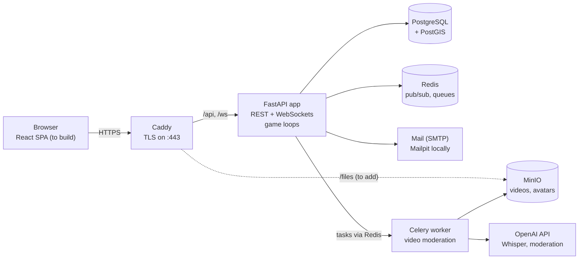

# ft\_transcendence — Backend Reference (WOZU)

Oct 27, 2026 · @byulbyul

## TL;DR

Copy the architecture and patterns, rebuild the schema clean, drop the legacy. The reference (`ft_transcendence-main`, `backend/fastapi`, entry point `app/main_ft.py`) works: 36 migrations apply and 127 tests pass on PostgreSQL 16 + PostGIS and Redis (checked 2026-10-27).

| Copy as is (pattern) | Rebuild cleaner | Drop |
| --- | --- | --- |
| Layering: routes → service → repo → models | Database schema: one fresh migration history, no legacy tables | Legacy chat `chat_threads` / `chat_messages` and `/chat/*` routes |
| Unified error body `{"error": {"code", "detail"}}` | Job status meaning (`active` vs `open`) | Phone and OTP fields on `users`, unused `username` |
| Argon2id hashing, JWT access + refresh rotation with `token_version` | Media upload path: MinIO over HTTPS, server-side checks | Resumes module (tables exist, router not mounted) |
| Redis pub/sub WebSocket manager | Game: room-scoped votes, min 3 players, history endpoint, reconnect | Anonymous draft videos and the demo feed (mobile onboarding features) |
| Cursor pagination, PostGIS radius search, full-text keyword search | Email links pointing to frontend pages | APScheduler, firebase-admin, flower, phonenumbers dependencies |
| Application state machine + event log | Moderation status enum | Test requirements inside the production image |
| Celery worker with late acknowledgement for moderation | Rate limits on all write endpoints |  |
| Transactional test fixtures |  |  |

## Architecture

One FastAPI process holds all business logic; Redis ties the API, WebSocket push and the Celery worker together; Caddy is the only door from the browser.



&#91;embedded content: WOZU Web architecture · 8 services, 2 still to build\]

Today Caddy only proxies the API, so the browser cannot reach MinIO for uploads. The Infrastructure doc covers the missing routes.

## Code layout and conventions

One package per domain with the same five files, so any member finds any endpoint in seconds. The reference is not fully uniform (jobs, users and companies have no \`repo.py\`); make the new backend uniform.

```
app/
  main.py              # app factory: middleware, exception handlers, routers, lifespan tasks
  core/                # config (env), errors, logging (structlog JSON), rate limiter, request-id, internal auth
  db/                  # declarative Base + naming convention, async session, mixins
  auth/                # register, verify, login, refresh, logout, passwords; deps.get_current_user
  users/  friends/  companies/  jobs/  applications/  conversations/  media/  game/
    models.py          # SQLAlchemy 2 typed models
    schemas.py         # Pydantic v2 request / response models
    repo.py            # queries only, no HTTP
    service.py         # business rules, raises HTTPException
    routes.py          # thin FastAPI router
  worker/              # Celery app + tasks (video moderation)
alembic/versions/      # migrations
tests/                 # pytest, async, one file per domain
```

**Conventions to keep**

- Error body is always `{"error": {"code": "<status>", "detail": "<text>"}}`; validation errors return the first failing field as `"field → message"`.
- Auth: `Depends(get_current_user)` (401 if missing) or `get_current_user_optional`. Access token carries `sub`, `scope`, `ver`; a password change bumps `users.token_version` and kills every token.
- Lists use cursor pagination: request `cursor` + `limit`, response `{items, next_cursor}`; `next_cursor = null` means the end.
- Soft delete through a `status` column (`active` / `deleted`), never row deletion for users, companies, jobs, videos.
- Every table has `created_at` / `updated_at` with server defaults (`TimestampMixin`); owner-edited tables add `created_by_id` / `updated_by_id`.
- Constants live in `*_constants.py`, never inline numbers (video limits, game timings).
- Background loops start in the app lifespan and log exceptions instead of dying.
- Every request gets an `x-request-id`, written into every log line of that request.

## Domain modules

Nine domains carry the product; the full endpoint list with request and response shapes is in the API Contract doc.

| Domain | Purpose | Endpoints (prefix) | Tables | Keep / change |
| --- | --- | --- | --- | --- |
| auth | Sign up, email verification, login, token refresh, logout, password change / reset | `/auth/*` (8) | `users`, `refresh_tokens`, `password_reset_tokens` | Keep; links in emails must open frontend pages |
| users | Own profile: read, full update, soft delete | `/users/me` (3) | `users` | Keep; add avatar URL + default avatar; make PATCH partial |
| friends | Friend requests, friends list with online flag, public profile | `/friends/*` (6), `/users/{id}/profile` | `friendships` | Keep; fix N+1 query in friends list |
| companies | One active company per employer user | `/companies`, `/companies/me` (4) | `companies` | Keep; `GET /companies/me` must not 404 for job seekers |
| jobs | Vacancies: CRUD, my jobs with view / application counters, public search | `/jobs/*` (6) | `jobs` (+ PostGIS `location_point`, `search_vector`) | Keep; clarify `active` (draft) vs `open` (published) |
| applications | Apply, withdraw, employer review with status transitions, job views | `/jobs/{id}/apply`, `/applications/*`, `/jobs/{id}/applications`, `/jobs/{id}/view` (7) | `applications`, `application_events`, `job_views` | Keep; only `open` jobs accept applications |
| conversations | Direct chats: messages, read state, edit / delete, participants | `/conversations/*` (13) | `conversations`, `conversation_participants`, `messages` | Keep as the only chat; broadcast edits / deletes over WebSocket |
| realtime | Per-user WebSocket push through Redis pub/sub | `WS /ws?token=` | none | Keep; move the token out of the URL; presence in Redis |
| media | Video resume upload, moderation, publish / unpost, feed; avatar and company logo upload | `/media/*` (15) | `intro_videos` | Keep core; drop drafts and demo feed; fix upload path and checks |
| game | Turing Duel: queue, rooms, chat over WebSocket, votes, results | `/game/*` (5), `WS /game/ws` | `game_rooms`, `game_participants`, `game_messages`, `game_votes` | Keep; fix votes, add history + reconnect |
| worker | Celery task: download video, extract frames + audio, transcribe, moderate | none | `intro_videos` | Keep; add Celery beat or drop the beat schedule |
| legacy chat | Older two-sided employer / job-seeker threads with polling | `/chat/*` (6) | `chat_threads`, `chat_messages` | Drop |
| resumes | Structured CV (experience, education, skills, languages) | not mounted in `main_ft` | 5 `resume_*` tables | Drop |

## Key business logic

These rules are where the product lives; port them deliberately, with their tests, not by copy-paste.

**Tokens and sessions**

- Access token: JWT HS256, 15 min, claims `iss`, `aud`, `iat`, `nbf`, `exp`, `jti`, `sub` (user id), `scope=access`, `ver` (= `users.token_version`).
- Refresh token: JWT, 30 days, stored by `jti` in `refresh_tokens`; every `/auth/refresh` revokes the old one and returns a new pair (rotation). Reuse of a revoked token → 401.
- Password change or reset: `token_version + 1` → every access and refresh token of that user dies at once.
- Email verification token: stateless JWT, `scope=email_verify`, 24 h. Login is refused with 403 until verified.
- Forgot password always answers 202, whether the email exists or not (no account enumeration). Reset token: random 64 chars in the database, 1 h, single use.

**Apply guard** (`applications/service.py`)

Before an application is created: profile must have first name, last name and position, else 422 `{"code": "profile_incomplete", "next_step": "profile"}`; the user must have a posted, approved video, else 422 `{"code": "no_video", "next_step": "video"}`. The frontend uses `next_step` to redirect. Then: job must accept applications, not your own company's job (403), no duplicate (409).

**Application states**

- Employer moves: `submitted → viewed | shortlisted | rejected`, `viewed → shortlisted | rejected`, `shortlisted → contacted | rejected`, `contacted → hired`.
- Applicant moves: `submitted | shortlisted → withdrawn`.
- Any other move → 409. Every move writes an `application_events` row. Moving to `contacted` creates (or reuses) a direct conversation linked to the job and the application.

**Chat**

- A direct conversation is unique per pair of users; `POST /conversations` returns the existing one.
- Send is idempotent with an optional `idempotency_key`. After commit the message is pushed over WebSocket to every participant.
- Unread count = messages after `last_read_message_id` not written by me. Edit window 15 min, own messages only; delete is soft.

**Video lifecycle**

1. Client asks `upload-url` → gets a presigned PUT URL for `users/{uid}/intro/{uuid}.mp4` (mp4 only, ≤ 30 s, ≤ 50 MiB, max 3 active videos).
2. Client uploads straight to MinIO, then calls `confirm` → row with `moderation=pending`, `lifecycle=loaded`; a Celery task starts.
3. Worker: download → 3 frames (5, 15, 25 s) + audio → Whisper transcript → OpenAI moderation on frames and text → `approved` (auto-posted, previous posted video becomes `unposted`) or `rejected` with the flagged categories.
4. User can post / unpost / delete. Only one posted video per user (partial unique index). Feed shows approved + posted videos with short-lived signed URLs.

**Turing Duel game**

1. `POST /game/queue/join` puts the user in a Redis sorted set. Every 5 s the matchmaking tick picks a random room size 2 to 5.
2. Enough players → room of humans. Oldest player waited 30 s → room filled with bots. Participants get anonymous labels ("Player 1"…).
3. Discussion 120 s: players chat over `WS /game/ws`; bots post template lines at random intervals with a fake typing delay.
4. Voting 45 s: each player marks every other participant `bot` or `human`.
5. Score: +1 per bot caught, −1 per human wrongly called a bot. Results reveal who was a bot and each bot's deception rate.

Phases advance on the server clock only; clients never request a phase change.

**Job search** (`GET /jobs/open`)

Filters combine with AND: radius around `lat`/`lng` (PostGIS `ST_DWithin`, up to 500 km), `schedule`, `salary_min` / `salary_max`, `urgency`, `position` (title substring), `keyword` (Postgres full-text on title + description, kept in `search_vector` by a trigger). Sort `newest` (id desc) or `nearest` (distance). Cursor = last job id.

## Database schema

The new backend needs 17 of the reference's 25 tables, created by one clean initial migration. Types below are PostgreSQL; `!` = NOT NULL; all ids are `auto-increment bigint`.

| Table | Key fields | Relations (on delete) | Notes |
| --- | --- | --- | --- |
| `users` | email! unique, password\_hash, is\_email\_verified!, first\_name, last\_name, position, birth\_date, bio, avatar\_object\_key, token\_version!, status! (`active`/`deleted`) | — | Drop `phone`, `is_phone_verified`, `deleted_phone`, `username` unless OAuth needs a login name |
| `refresh_tokens` | jti! unique, token\_version!, expires\_at!, revoked! | user → users (cascade) | Purged hourly |
| `password_reset_tokens` | token! unique (64), expires\_at!, used\_at | user → users (cascade) | Single use |
| `friendships` | requester\_id!, addressee\_id!, status! (`pending`/`accepted`/`declined`) | both → users (cascade) | Partial unique index on the unordered pair while pending or accepted |
| `companies` | owner\_user\_id!, name!, description, logo\_object\_key, status!, country, city, district, country\_code | owner → users (cascade) | One active company per owner (enforced in code; add a partial unique index) |
| `jobs` | owner\_id!, title!, description!, status! (`active`/`open`/`deleted`), latitude!, longitude!, location!, salary\_amount, salary\_type!, salary\_currency, schedule!, urgency!, location\_point (geography), search\_vector (tsvector) | owner → companies (cascade) | Check constraints on lat/lng ranges, salary ≥ 0, ISO-4217 currency; GiST + GIN indexes; trigger fills `search_vector` |
| `applications` | job\_id!, applicant\_id!, company\_id!, intro\_video\_id, status!, cover\_note, conversation\_id, applied\_at!, viewed\_at | job, company, applicant (cascade); video, conversation (set null) | Unique (job\_id, applicant\_id) |
| `application_events` | application\_id!, actor\_id, from\_status, to\_status!, note | application (cascade), actor (set null) | Audit trail of status moves |
| `job_views` | job\_id!, viewer\_id, viewed\_at! | job (cascade) | Deduplicated per user per 24 h through Redis |
| `conversations` | type! (`direct`/`group`/`ai`), title, job\_id, application\_id, last\_message\_id | job, application (set null) | `last_message_id` has no FK (circular); keep it that way |
| `conversation_participants` | conversation\_id!, user\_id!, role!, last\_read\_message\_id, is\_muted!, left\_at | conversation, user (cascade) | Unique (conversation\_id, user\_id) |
| `messages` | conversation\_id!, author\_id, content!, status! (`sent`/`delivered`/`read`), reply\_to\_id, idempotency\_key, message\_type!, edited\_at, deleted\_at | conversation (cascade), author (set null), reply\_to (set null) | Unique (conversation\_id, idempotency\_key) |
| `intro_videos` | user\_id!, object\_key! unique, duration\_sec!, size\_bytes!, content\_type!, moderation\_status!, rejected\_reason, lifecycle\_status!, video\_rating! | user (cascade) | Add `moderation_error` to the enum; one posted video per user (partial unique index) |
| `game_rooms` | target\_size!, state! (`waiting`/`discussion`/`voting`/`finished`), discussion\_started\_at, voting\_started\_at, finished\_at | — |  |
| `game_participants` | room\_id!, user\_id (null = bot), display\_label!, score! | room (cascade), user (set null) | Add unique (room\_id, user\_id) for humans |
| `game_messages` | room\_id!, participant\_id!, text!, sent\_at! | room, participant (cascade) | Needed for reconnect history |
| `game_votes` | room\_id!, voter\_participant\_id!, target\_participant\_id!, guess! (`bot`/`human`) | room, voter, target (cascade) | Unique (voter, target); target must be in the same room |

**Drop:** `chat_threads`, `chat_messages` (legacy chat), `resumes`, `resume_experiences`, `resume_educations`, `resume_skills`, `resume_languages` (router not mounted), `draft_videos` (anonymous mobile onboarding).

The README needs a visual schema; generate it from the new database (for example with SchemaSpy or `eralchemy`) instead of drawing it by hand, so it never drifts.

## Issues not to copy

25 issues found by reading the code and checking the database; the first eight break a module or the mandatory part at the defense. Each row can become one Trello card.

| # | Issue | Where | Impact | Fix in the new backend |
| --- | --- | --- | --- | --- |
| 1 | Presigned URLs point at the internal `minio:9000` over HTTP unless `MINIO_EXTERNAL_ENDPOINT` is set; Caddy does not route to MinIO | `media/minio_client.py`, compose, Caddyfile | Browser cannot upload video, avatar or logo; HTTPS rule broken | Expose MinIO through Caddy TLS, sign URLs for that host, bucket CORS for the frontend origin |
| 2 | `moderation_error` status is written by the worker but missing from the `moderation_status` enum | `media/moderation_task.py`, migrations | Any download or ffmpeg failure raises a DB error; video stays `pending` | Add the value to the enum, cover with a test |
| 3 | Celery beat schedule (requeue stuck videos) is defined but no beat process runs | `worker/celery_app.py`, compose | Stuck videos are never retried | Run the worker with `-B` or a beat service |
| 4 | Verify and reset links point at the API; the reset link targets a POST-only route | `auth/email_routes.py`, `auth/password_routes.py` | Clicking the email links shows JSON or 405 | Links go to frontend routes, which call the API |
| 5 | Email only through the Brevo HTTP API; without a key the link is only printed | `auth/emails.py` | Evaluator cannot verify an account | SMTP sender + Mailpit container in compose |
| 6 | Votes are not checked to target a participant of the same room; unknown ids hit the FK and return 500 | `game/routes.py` | Cross-room cheating, server errors | Validate target belongs to the room |
| 7 | Game rooms can have 2 players | `game/constants.py` | Multiplayer 3+ module needs 3+ | Minimum size 3, bots fill the rest |
| 8 | No game message history endpoint, no rejoin flow | `game/` | A page reload loses the room chat; weak real-time story | `GET /game/rooms/{id}/messages` + resync on WebSocket connect |
| 9 | Game WebSocket skips the `token_version` check | `game/ws_routes.py` | Revoked tokens still work there | Share one authenticate helper with `/ws` |
| 10 | Apply accepts jobs in `active` (unpublished) status | `applications/service.py` | Users can apply to drafts | Only `open` jobs |
| 11 | Linking a conversation to a job requires `active`, while public jobs are `open` | `conversations/routes.py` | Cannot attach published jobs | Define one rule for draft vs published and use it everywhere |
| 12 | Avatar / logo confirm accepts any object key; extension is not validated | `media/handlers/handlers_profile.py` | A user can point their avatar at another user's file | Check the key prefix is the caller's; whitelist jpg / png / webp |
| 13 | Confirm trusts client-reported size and duration; never checks the object exists | `media/handlers/handlers_confirm.py` | Fake or missing videos enter moderation | `stat_object` on confirm; real duration from ffprobe in the worker |
| 14 | No endpoint returns an avatar URL; no default avatar | users, friends | Frontend cannot show avatars | Return a signed `avatar_url` (or a public avatars path) + default image |
| 15 | `GET /companies/me` returns 404 for users without a company | `companies/routes.py` | Chrome console error on every job-seeker page load | Return 200 with `null` |
| 16 | WebSocket token in the query string | `chat/ws_routes.py`, `game/ws_routes.py` | Access tokens land in proxy access logs | Short-lived one-time WS ticket, or auth in the first message |
| 17 | Message edit / delete are not pushed over WebSocket | `conversations/routes.py` | Other side sees stale messages | Broadcast `message_updated` / `message_deleted` |
| 18 | Online status is per-process memory | `chat/connection_manager.py` | Wrong with more than one worker | Presence keys in Redis with TTL |
| 19 | Matchmaking and phase loops run in every API worker; bots are in-process tasks | `main_ft.py`, `game/matchmaking.py` | Duplicate rooms; bots die on restart | Redis lock per tick, or one dedicated worker |
| 20 | Rate limits only on auth; anonymous draft upload unlimited | `core/limiter.py` usage | Abuse of uploads and writes | Limits on all write endpoints |
| 21 | `/media/health` is public and prints internal endpoints | `media/handlers/handlers_health.py` | Information leak | Move under `/_internal` |
| 22 | Friends list loads each friend with a separate query | `friends/routes.py` | N+1 queries | One join |
| 23 | Test DB defaults to the app DB; test requirements installed in the production image; `minio:latest` unpinned | `.env.example`, Dockerfile, compose | Risky tests, bigger image, surprise upgrades | Separate test DB, multi-stage image, pinned tags |
| 24 | `auth/README.md` describes an older design (bcrypt, 120-min tokens, no refresh) | docs | Misleads new developers | Regenerate docs from code and OpenAPI |

**One more for media (#25):** the worker downloads videos through the external presigned URL. Once that URL is `https://<domain>/files/...`, a container cannot reach it (inside the container `localhost` is itself). Download with the internal MinIO client (`download_object` already exists in `minio_client.py`).

## Port order

Four phases, one card per row, each card = one PR by its owner. Phase 1 unblocks the frontend; phases 2 and 3 can run in parallel between the two backend devs.

| Phase | Card | Owner | Depends on | Modules |
| --- | --- | --- | --- | --- |
| 1 Foundation | Project skeleton: app factory, core (config, errors, logging, limiter, request id), db session, health, Dockerfile (multi-stage) | BE-A | — | M1, M5 |
| 1 Foundation | Initial migration with the 17-table schema | BE-A | skeleton | M5 |
| 1 Foundation | Auth: register, verify (frontend link), login, refresh, logout, passwords; SMTP sender | BE-A | migration | Mandatory |
| 1 Foundation | Users: `/users/me` (partial PATCH), avatar URL + default avatar | BE-A | auth | M4 |
| 2 Social | WebSocket layer: ticket auth, Redis pub/sub, presence in Redis, reconnect-safe | BE-A | auth | M2 |
| 2 Social | Friends + public profile (single-query list) | BE-B | users | M3, M4 |
| 2 Social | Conversations + messages + read state; broadcast new / edited / deleted | BE-B | WebSocket layer | M3, M2 |
| 3 Jobs | Companies (no 404 for job seekers) | BE-B | users | — |
| 3 Jobs | Jobs CRUD + search (geo, full-text, filters, cursor) | BE-B | companies | M6 |
| 3 Jobs | Applications: apply guard, state machine, events, job views | BE-B | jobs, media | — |
| 3 Jobs | Media: upload URL, confirm with `stat_object`, post / unpost / delete, feed, avatar + logo | BE-A | users, infra MinIO TLS | M4 |
| 3 Jobs | Worker: moderation task, fixed enum, beat for stuck videos | BE-B | media | M9 |
| 4 Game | Rooms, matchmaking with Redis lock, min 3 players, bots | BE-B | WebSocket layer | M7, M8 |
| 4 Game | Game WebSocket, room history endpoint, resync on connect, room-scoped votes, results with winner | BE-A | rooms | M7, M8 |
| Later | OAuth 2.0 with 42 intra | BE-A | auth | M15 |
| Later | Prometheus metrics endpoint (`/metrics`) for the infra dashboards | BE-B | skeleton | M12 |

After each card the owner updates the API Contract doc if the API changed.

## Tests

The 127 reference tests are the best specification we have: port each domain's tests with its code, then make them pass.

- **How they work:** each test runs inside one database transaction that is rolled back at the end; `commit()` is replaced by `flush()`, so rows stay visible inside the test and nothing persists. The HTTP client calls the app in-process (`httpx.ASGITransport`), no server needed.
- **Mocked by default:** emails, MinIO, the Celery `delay()` call and WebSocket sends. Real: PostgreSQL + PostGIS and Redis (rate-limit storage, matchmaking queue, view dedup).
- **Coverage by file:** auth, security (auth, applications, cross-user access), users, companies, jobs, applications, conversations, friends, media, draft video, game matchmaking, game voting, workers.
- **Run:** `docker compose run --rm api pytest -q` against a separate test database (`TEST_DATABASE_URL`), never the app database.
- **Add for the new backend:** WebSocket tests (connect, auth failure, broadcast), the fixed issues above (one regression test each), and CI that runs the suite on every PR.
