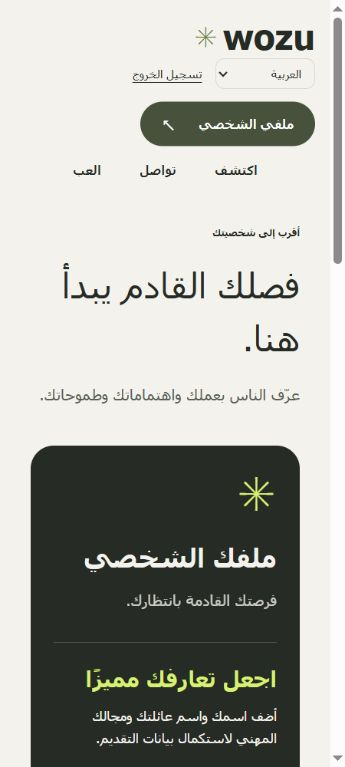

# FE-07 / FE-08: translation and Arabic layout review

Owner: Zayid Elkahir. Sprint 3, due November 24, 2026 at 18:00 Abu Dhabi.
[FE-07](https://trello.com/c/Dqc62LOP) · [FE-08](https://trello.com/c/g4MC9MRU).

## Implementation

English, Arabic, Azerbaijani, Turkish and Russian now have every shipped interface namespace. This includes auth, account settings, profile, people, jobs, applications, video, chat, the legal-page shell, common controls, status and game rules. Employer and friends resources include the keys needed by pending PRs #91 and #90; their screens are not part of this branch. Routes still marked Coming Soon on main remain placeholders.

`src/i18n/index.ts` discovers each locale's JSON resources. `useTranslation` subscribes components to language changes. Existing auth/account copy helpers resolve translations at render time through `translatedCopy`; form values and session state survive switching. Known persisted UI errors are retranslated by `localizeMessage`. General jobs/chat/media failures use translated recovery messages; arbitrary backend validation details on profile/auth are preserved, not falsely described as fully translated. API error-code coverage needs to grow with backend contracts.

`Intl` formats dates, numbers and salaries using the selected language. Count messages use i18next plural categories, including Arabic zero/one/two/few/many/other and Russian one/few/many/other. English fallback remains a runtime safety net, not an exemption from the catalog check.

`npm run i18n:check` rejects missing keys, missing required plural forms, unknown keys, blank values and interpolation mismatches in all four target locales. A separate JSX scan rejects untranslated production literals. Neither check proves linguistic quality or discovers all computed/server-provided text.

## Arabic behavior

Switching Arabic sets `html.lang=ar` and `html.dir=rtl` without navigation. Logical spacing, borders and positions follow direction; directional arrows mirror. Arabic typography has readable line height and no Latin tracking. Shell content wraps on mobile. Text fields use `dir=auto`; email, password, URL and numeric controls retain LTR order. Mixed names and job titles use bidirectional isolation. Tabs use visual arrow direction, skip disabled items and retain Home/End behavior.

## Verification on November 22

- Full frontend suite: 274 tests passed after the final persisted-error, tab-direction and localized relative-time changes.
- Typecheck, lint, strict catalog checks, formatting, legal synchronization and production build passed. The existing large-bundle warning remains; eager language resources increase the bundle.
- Live auth integration against the disposable main backend: all 3 tests passed (registration/verification/session and password lifecycle exercised by the existing harness).
- Browser: all five homepage languages at 360px had no horizontal document overflow. Arabic desktop home, mobile profile/settings, sign-in failure, switch to Russian with the existing error, successful sign-in, and mixed Arabic/English direct-chat sending were checked against the local backend.
- Screenshots below use disposable fixtures. They do not establish a complete cross-browser or every-screen audit; FE-16 owns additional browsers. Game rooms, employer pages and friends pages need a follow-up after their pending implementations land.

## Acceptance still pending

1. Fluent speakers must review AR, AZ, TR and RU. All new translations are **unreviewed drafts** until recorded below. Before code freeze, hide any incomplete language as FE-07 requires; at least three complete languages are needed for the module claim.
2. Approved legal document bodies remain their English originals with explicit language/direction and a translated notice. They are **not** translated by this change. `docs/legal/` remains canonical; translated legal documents need content-owner review before publishing, as established in `legal-pages.md`. This leaves FE-07's legal-text checklist open.
3. Account-level language persistence is blocked by the current backend contract: `UserOut` has no language field and `UserUpdate` rejects extra fields. The switcher saves locally and sends Accept-Language. Do not send an unsupported PATCH or claim cross-device persistence.
4. The locally tested main backend resolves `/api/jobs/open` as a numeric job ID and returns 422. The UI now shows localized recovery text; successful live search requires the search backend contract. This PR does not fix or hide that dependency.
5. Khalil's review and green CI are merge gates. These cards must not be marked Done yet.

| Language    | Fluent reviewer | Status  |
| ----------- | --------------- | ------- |
| Arabic      | Unassigned      | Pending |
| Azerbaijani | Unassigned      | Pending |
| Turkish     | Unassigned      | Pending |
| Russian     | Unassigned      | Pending |

## Adding or changing copy

Add the English key and its four translations together. Preserve interpolation names; use whole sentences rather than assembling translated fragments. Subscribe the component to the namespace. For counts, pass `count` and provide every locale-required plural category. Keep backend enums, identifiers and payload field names unchanged. User-generated content is not translated. Run catalog checks, the affected feature tests, typecheck and lint, then inspect both LTR and RTL layouts. Record reviewer/date here after a real language review.

Study exercise: change one Arabic validation message, cause that error, switch to Russian without clearing the form and explain why the error changes but the input value does not. In a practice branch, remove a Russian plural form and verify the catalog check fails.
